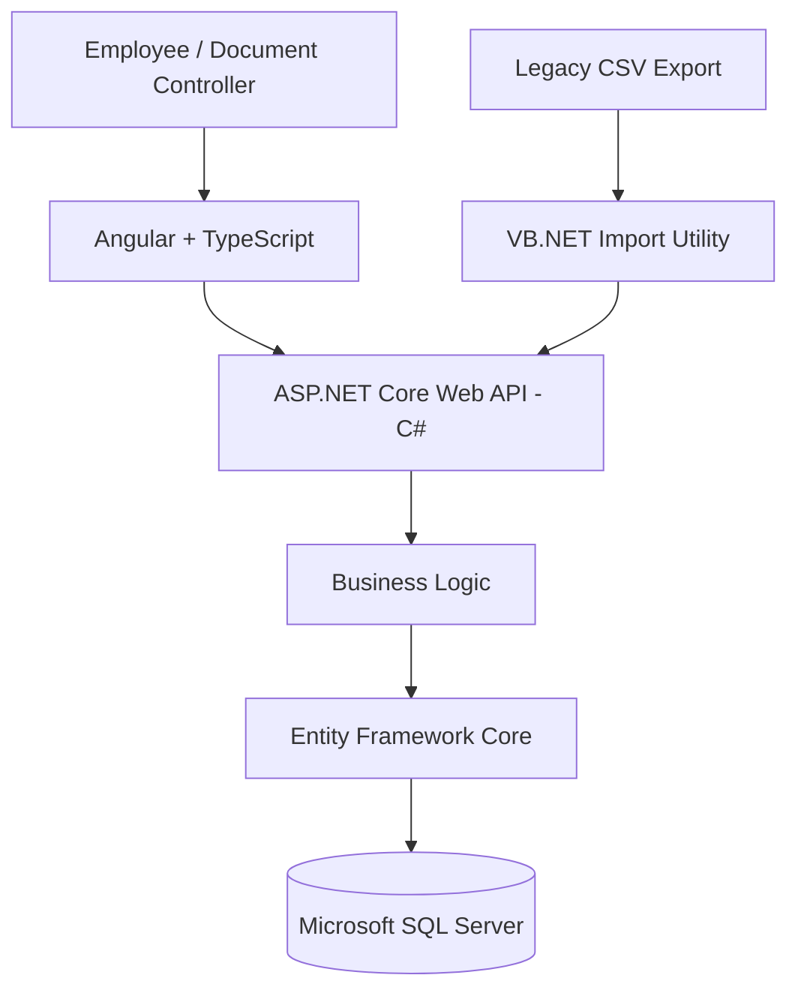

# Architecture

## High-Level Components

## Responsibilities

### Angular frontend
Provides the user interface for searching, viewing and creating document records. It communicates with the API over HTTP and does not connect directly to SQL Server.

### ASP.NET Core API
Validates requests, applies business rules and exposes documented REST endpoints. It is the single application entry point for data changes.

### Entity Framework Core
Maps C# entities to relational tables and handles persistence.

### Microsoft SQL Server
Stores document metadata and supports relational integrity, querying and reporting.

### VB.NET legacy importer
Simulates an older business application exporting document metadata to CSV. The importer validates rows and sends valid records through the REST API, rather than writing directly to the database.

## Key Design Decisions

1. The frontend never connects directly to the database.
2. The importer uses the same API as the web frontend, centralising validation.
3. Document metadata and physical file storage are separate concerns.
4. Revisions should be append-only; old revisions should not be overwritten.
5. Production authentication, authorization and deployment hardening are explicitly outside the first local demo.
